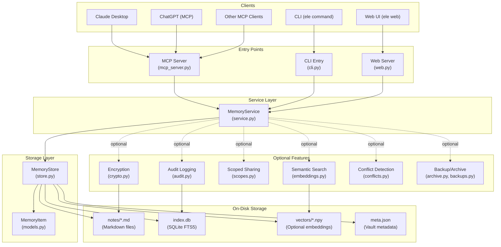

# EleSync Architecture Diagram

## High-Level Architecture



## Component Details

### 1. Entry Points

#### CLI (`cli.py`)
- Main command-line interface with `ele` command
- Main commands (partial list; `ele --help` has all): `add`, `search`, `forget`, `supersede`, `history`, `link`, `related`, `scope`, `sync`, `import`, `export`, `web`, `serve`, `onboard`, `doctor`
- Handles vault resolution, encryption unlocking, and user interaction
- Delegates to Service layer for core operations

#### MCP Server (`mcp_server.py`)
- Exposes vault over Model Context Protocol
- Supports stdio (local) and Streamable HTTP (remote) transports
- Wraps Service layer methods as MCP tools
- Handles scoped sharing and audit logging via environment variables
- ~600 LOC thin protocol wrapper

#### Web Server (`web.py`)
- Local web UI at `http://127.0.0.1:7477`
- Pure Python stdlib HTTP server (no extra dependencies)
- Supports optional password authentication via `web_auth.py`
- Drag-and-drop import, memory management, search

### 2. Service Layer (`service.py`)

Core business logic methods:
- **recall**: Search memories with filters (query, source, type, scopes)
- **remember**: Add new memories with auto-supersession
- **forget**: Remove memories with conflict detection
- **scope**: Change memory scope tags
- **status**: Vault statistics and conflict reports
- **conflicts**: Find and manage contradictory facts

Features:
- Scoped sharing enforcement (per-client visibility)
- Auto-supersession of conflicting facts
- Read-only mode for restricted clients
- Audit logging integration

### 3. Storage Layer (`store.py`)

**MemoryStore** - Local-first storage with dual representation:

1. **Markdown files** (`notes/<id>.md`)
   - Source of truth, human-readable
   - YAML front-matter + body
   - Git-friendly, Obsidian-compatible
   - Optional encryption: `.md.enc` files

2. **SQLite index** (`index.db`)
   - FTS5 full-text search
   - Fast queries for MCP server
   - Derived cache (rebuildable from markdown)
   - Optional: In-memory only for encrypted vaults

**Operations**:
- `add()`: Write markdown + update index
- `search()`: Query SQLite with optional semantic similarity
- `reindex()`: Rebuild index from markdown files
- `get()`, `update()`, `delete()`: CRUD operations

### 4. Data Model (`models.py`)

**MemoryItem** dataclass:
```python
@dataclass
class MemoryItem:
    content: str           # The memory text
    source: str            # claude, chatgpt, manual, etc.
    type: str              # fact, preference, project, etc.
    tags: list[str]        # User-defined tags
    scopes: list[str]      # Visibility compartments
    confidence: float      # 0.0-1.0
    created_at: str        # ISO-8601 timestamp
    source_ref: str        # Original conversation/export ID
    id: str                # Stable UUID
    content_hash: str      # For deduplication
    superseded_by: str     # ID of replacement memory
    superseded_at: str     # When superseded
```

### 5. Optional Features

#### Encryption (`crypto.py`)
- **Threat model**: Protection at rest (stolen disk, leaked backup)
- **Algorithm**: XSalsa20-Poly1305 (libsodium SecretBox)
- **Key derivation**: argon2id with salt + params in `vault.json`
- **Behavior**: Encrypts markdown to `.md.enc`, removes plaintext index
- **Locked mode**: In-memory index with live decryption

#### Semantic Search (`embeddings.py`)
- **Model**: BAAI/bge-small-en-v1.5 (ONNX, ~30MB)
- **Storage**: Float32 vectors in SQLite index
- **Search**: Hybrid keyword (FTS) + vector similarity
- **Dependency**: Optional `fastembed` extra

#### Scoped Sharing (`scopes.py`)
- **Purpose**: Per-client memory compartments
- **Model**:
  - Memories have scope labels (empty = general)
  - Clients have grants (env var `ELESYNC_SCOPES`)
  - Visibility = intersection of memory scopes & client grant
- **Use cases**: Legal, health, personal vs. work compartments

#### Conflict Detection (`conflicts.py`)
- **Purpose**: Detect contradictory facts
- **Method**: Jaccard word overlap similarity (threshold-based)
- **Scope**: Flags `fact` types with high overlap but different values
- **Limitations**: Heuristic, not semantic understanding
- **Integration**: Auto-supersession for isolated pairs

#### Audit Logging (`audit.py`)
- **Format**: JSON-lines (`audit.jsonl`)
- **Operations**: REMEMBER, RECALL, FORGET, SCOPE, STATUS, CONFLICTS
- **Properties**: Append-only, thread-safe, fail-open
- **Activation**: `ELESYNC_AUDIT=1` or `--audit` flag

#### Backup/Archive (`archive.py`, `backups.py`)
- **Format**: Versioned envelope with magic header
- **Structure**:
  - Header: plaintext metadata (count, encryption state)
  - Body: gzip + optional encryption
- **Features**: Self-describing, listable without passphrase
- **Commands**: `ele backup`, `ele restore`, `ele backup list`

### 6. Supporting Modules

#### Normalization (`normalize.py`)
- Import adapters for ChatGPT, Claude, Gemini, Copilot
- Maps diverse export formats to MemoryItem schema
- Deduplication by content hash

#### Internationalization (`i18n.py`)
- Message catalog for user-facing strings
- Language detection from environment
- Interactive language selection

#### USB Support (`usb.py`)
- Detect and handle vaults on removable drives
- Vault portability across machines

#### Onboarding (`onboarding.py`)
- Interactive setup wizard
- MCP client configuration (Claude Desktop, etc.)
- Vault initialization

## Data Flow Examples

### Adding a Memory (CLI)
```
ele remember "Prefers concise code reviews"
  ↓
cli.py: _resolve_vault() → get vault path
  ↓
cli.py: _store() → open MemoryStore
  ↓
service.py: remember() → normalize, validate
  ↓
store.py: add() → write notes/<id>.md + update index.db
  ↓
crypto.py (if encrypted) → encrypt to .md.enc
  ↓
embeddings.py (if semantic) → generate vector
  ↓
audit.py (if enabled) → log operation
```

### Recall via MCP
```
Claude Desktop: "What do you remember about me?"
  ↓
MCP: recall tool call
  ↓
mcp_server.py: recall() → parse request
  ↓
service.py: recall() → apply scope filter
  ↓
store.py: search() → FTS5 query + optional vector similarity
  ↓
Return filtered MemoryItems as formatted text
```

### Conflict Resolution
```
Two memories: "Lives in Westbrook" vs "Lives in Portland"
  ↓
service.py: conflicts() → find similar facts
  ↓
conflicts.py: find_conflicts() → Jaccard similarity
  ↓
If isolated pair (exactly 2): suggest supersede
  ↓
User: ele supersede <id1> --by <id2>
  ↓
service.py: supersede() → mark old as superseded
  ↓
store.py: update() → write new metadata
```

## Configuration

### Environment Variables
- `ELESYNC_DIR`: Vault path (default: `~/EleSyncVault`)
- `ELESYNC_PASSPHRASE`: Encryption passphrase
- `ELESYNC_SEMANTIC`: Enable semantic search
- `ELESYNC_SCOPES`: Client scope grant
- `ELESYNC_WRITE_SCOPE`: Default write scope
- `ELESYNC_AUDIT`: Enable audit logging
- `ELESYNC_AUTO_SUPERSEDE`: Enable auto-conflict resolution

### Vault Structure
```
~/EleSyncVault/
├── notes/              # Markdown files (source of truth)
│   ├── <id1>.md
│   └── <id2>.md.enc   # Encrypted notes
├── index.db           # SQLite FTS5 index
├── vectors/           # Optional semantic embeddings
│   └── <id>.npy
├── meta.json          # Vault metadata
├── vault.json         # Encryption metadata
├── audit.jsonl        # Audit log (optional)
└── .obsidian/         # Obsidian config
```

## Testing

Comprehensive test suite in `tests/`:
- `test_vault.py`: Core storage operations
- `test_service.py`: Service layer logic
- `test_encryption.py`: Crypto functionality
- `test_scopes.py`: Scoped sharing
- `test_conflicts.py`: Conflict detection
- `test_web.py`: Web UI
- `test_mcp_auth.py`: MCP server auth
- `test_backup_*.py`: Backup/archive functionality
- Integration tests for end-to-end flows

## Design Principles

1. **Local-first**: No server, no daemon, no cloud
2. **Files as source of truth**: Human-readable markdown
3. **Optional dependencies**: Core works with stdlib only
4. **Recoverability**: Index rebuildable from markdown
5. **Privacy**: Encryption at rest, scoped sharing
6. **Portability**: USB vaults, git-friendly
7. **MCP-native**: Standard protocol for AI clients
8. **Testability**: Pure functions, clear layers
